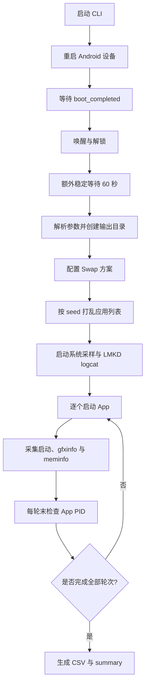

<div align="center">

# 🚇 RushHour-benchmark

**早高峰 · 面向 rooted Android 设备的多应用启动、内存压力与进程存活率基准测试工具**

`Kotlin/JVM` · `ADB` · `Coroutines` · `Clikt` · `Gradle`

🚀 启动性能　·　🧠 内存压力　·　💾 Swap 对比　·　🌡️ 温度监控　·　❤️ 进程存活率

</div>

---

## 🚇 名字由来

早高峰的地铁：车厢（内存）只有那么大，乘客（App）一站站往上挤，先上车的被压得最久，挤不上去的只能被请下车。

这个项目测的正是同一件事：

- 一轮连续启动 = 一趟车，`launchPosition` = 上车顺序
- zRAM / Flash Swap = 把行李压缩、挪到行李车，好让车厢再多塞几个人
- LMKD 杀进程 = 挤不下时被请下车，`survival.csv` 记录谁一直站到了终点
- `am start -W` 的耗时与渲染延迟 = 越挤，开门关门（启动）变得有多慢

---

## 📖 项目简介

本项目是运行在主机端的 Kotlin/JVM CLI 工具。它会按照指定顺序连续启动一组 Android App，并在不同 Swap 方案下采集启动性能、系统内存、I/O、温度及进程存活情况。

适合研究以下问题：

- No Swap、zRAM、Flash Swap、zSwap 对多任务体验有什么影响？
- App 冷启动、温启动、热启动的耗时有何差异？
- 多个 App 连续启动后，有多少原始进程仍然存活？
- memory PSI、Swap I/O、温度与 LMKD 杀进程之间是否有关联？
- App 的启动位置是否影响其轮末存活概率？

### ✨ 主要能力

| 能力 | 采集内容 |
|---|---|
| 🚀 启动性能 | `am start -W` 的 LaunchState、TotalTime、WaitTime、Status |
| 🎞️ 渲染性能 | Janky frames、P50/P90/P95/P99 渲染延迟 |
| 🧠 App 内存 | `dumpsys meminfo` 的 Total PSS |
| 📊 系统状态 | `/proc/meminfo`、memory PSI、`vmstat` |
| 💾 Swap | zRAM、backing device、zSwap 计数器与估算带宽 |
| 🌡️ 温度 | BIG、MID、LITTLE、SoC、Virtual Skin 温度 |
| ☠️ LMKD | 过滤并保存 Low Memory Killer 日志 |
| ❤️ 存活率 | 原 PID 存活状态、轮末 App 运行状态 |
| 👆 交互模拟 | 为不同 App 预留触控策略，支持短视频上滑操作 |

---

## ⚠️ 使用前必读

> [!CAUTION]
> 本工具会重启设备，并可能执行 `swapoff`、创建 4 GB Swap 文件、运行 `mkswap`/`swapon`、挂载 debugfs 和修改 zSwap 参数。请仅在专用测试设备上运行，避免在日常主力设备上使用。

> [!IMPORTANT]
> 当前程序先重启设备，再解析 CLI 参数。即使参数无效或仅传入 `--help`，设备也可能已经开始重启。

---

## 🔄 一次测试如何运行



默认每次运行包含 5 个 round。每个 round 会按照同一应用顺序启动全部 App，然后检查本轮启动进程是否存活。

> [!NOTE]
> 当前 `Main.kt` 虽然在每轮后对局部变量执行了 `apps.reversed()`，但 `ExperimentRunner` 已在创建时持有原列表，因此实际各轮仍使用相同顺序。

---

## 🧰 环境要求

### 💻 主机环境

- Linux 或 WSL
- JDK 21
- Python 3.12 和 `python3.12-venv`
- 项目自带 Gradle Wrapper 8.7
- 命令行可直接执行 `adb.exe`

代码目前明确使用 `adb.exe`，主要面向 WSL 调用 Windows Android Platform Tools。原生 Linux 用户需要将以下文件中的 `adb.exe` 改为 `adb`：

- [`AdbCommands.kt`](app/src/main/kotlin/com/junj/device/adb/AdbCommands.kt)
- [`LogcatProcess.kt`](app/src/main/kotlin/com/junj/device/logcat/LogcatProcess.kt)

### 📱 Android 设备

- 设备已通过 ADB 连接并处于 `authorized` 状态
- 设备具有 root 权限
- `adb shell su -c sh` 可执行
- 被测 App 已安装，包名和启动 Activity 与项目配置一致
- 锁屏未设置 PIN、密码或图案，或者运行前已手动解锁
- Flash Swap 模式允许写入 `/data/per_boot/`
- zSwap 模式的内核支持 zSwap 和 debugfs

建议先检查：

```bash
adb.exe devices
adb.exe shell su -c id
adb.exe shell pm list packages
```

---

## 🚀 快速开始

### 1️⃣ 创建 Python 虚拟环境

```bash
python3 -m venv app_actions/.venv
app_actions/.venv/bin/python3 -m pip install -r app_actions/requirements.txt
```

虚拟环境位于 `app_actions/.venv`，已加入 `.gitignore`，不会提交到仓库。

### 2️⃣ 编译

```bash
./gradlew :app:compileKotlin
```

### 3️⃣ 运行测试

```bash
./gradlew run --args="-t <swap-type> -a <app-set>"
```

例如，使用 zRAM、中等应用集合和随机种子 `42`：

```bash
./gradlew run --args="-t 1 -a 1 --seed 42"
```

为输出目录添加实验标识：

```bash
./gradlew run --args="-t 3 -a 2 --seed 42 --logPath run01"
```

### 4️⃣ 运行单元测试

```bash
./gradlew :app:test
cd app_actions && .venv/bin/python3 -m unittest test_run_app.py
```

---

## 🎛️ CLI 参数

| 参数 | 必填 | 默认值 | 说明 |
|---|:---:|---:|---|
| `-t`, `--type` | ✅ | — | Swap 类型，取值 `0..3` |
| `-a`, `--app-set` | ✅ | — | 应用集合，取值 `0..2` |
| `-s`, `--seed` | ❌ | `0` | 应用初始顺序的随机种子 |
| `-p`, `--logPath` | ❌ | — | 添加到输出目录名末尾的标识 |

> `--logPath` 当前不是任意文件系统路径，只是输出目录名的后缀。

### 💾 Swap 类型

| `--type` | 模式 | 当前代码执行的操作 |
|---:|---|---|
| `0` | 🚫 No Swap | 对 `/dev/block/zram0` 执行 `swapoff` |
| `1` | ⚡ Only zRAM | 保持设备启动后的现有 zRAM 配置 |
| `2` | 💽 Flash Swap | 关闭 zRAM，创建并启用 `/data/per_boot/flash.swap` |
| `3` | 🔁 zSwap | 关闭 zRAM，启用 Flash Swap、zSwap，并挂载 debugfs |

Flash Swap 默认大小为 `4096 MB`。

> [!WARNING]
> 当前初始化代码不会全面清理上一次实验遗留的所有 Swap/zSwap 状态。严谨实验应在每次运行前检查 `/proc/swaps`、zSwap enabled 状态和实际 backing device。

### 📦 应用集合

应用和启动 Activity 定义在 [`AppCatalog.kt`](app/src/main/kotlin/com/junj/domain/app/AppCatalog.kt)。

| `--app-set` | 名称 | 数量 | 应用 |
|---:|---|---:|---|
| `0` | 🟢 Light | 10 | 微信、微博、知乎、QQ 音乐、大众点评、携程、京东、美团、百度网盘、夸克 |
| `1` | 🟡 Middle | 12 | 微信、微博、知乎、QQ 音乐、大众点评、携程、美团、百度网盘、夸克、WPS、豆包、高德地图 |
| `2` | 🔴 Heavy | 16 | 当前应用目录中的全部 App，包含抖音、快手和哔哩哔哩 |

### 🎲 随机种子

程序在测试开始前使用 seed 对应用列表进行一次打乱。使用相同 seed，可以复现相同初始顺序：

```bash
# 不同 Swap 方案使用同一应用顺序
./gradlew run --args="-t 0 -a 0 --seed 100"
./gradlew run --args="-t 1 -a 0 --seed 100"
```

最终顺序会写入 `summary.txt`：

```text
randomSeed=100, appOrder=wechat, zhihu, ...
```

---

## ⏱️ 当前默认配置

配置常量位于 [`ExperimentConfig.kt`](app/src/main/kotlin/com/junj/config/ExperimentConfig.kt)。

| 配置 | 值 | 当前实际作用 |
|---|---:|---|
| 测试轮数 | 5 | 每次运行执行 5 个 round |
| `sampleIntervalMs` | 2,000 ms | 固定采样周期（绝对时刻调度），同时作为 CSV 带宽计算的除数 |
| 相邻 App 启动间隔 | 15,000 ms | 使用 monotonic deadline 控制 |
| gfxinfo/meminfo 收集时刻 | 启动后 12,000 ms | 在此时读取渲染与 PSS 数据 |
| Flash Swap 大小 | 4096 MB | 创建 Flash Swap 文件时使用 |
| 重启后稳定等待 | 60,000 ms | 解锁后额外等待后台服务稳定 |

### 📈 当前采样节拍

系统采样一轮要读 [`vmstat 1 2`](app/src/main/kotlin/com/junj/metrics/MetricsCollector.kt)、`/proc/meminfo`、`/proc/pressure/memory`、`dumpsys thermalservice`、zRAM 的 `mm_stat`/`bd_stat` 和 4 个 zSwap 计数器。

解析器跳过两行表头并读取最后一行，因此 vmstat 的速率和 CPU 字段代表最近约 1 秒的区间值，而非设备启动以来的首行平均值。

这些命令被合并成**一次 adb 调用**：整段脚本通过 stdin 交给设备上的 `su -c sh` 顺序执行，每段数据前打印一行 `@@DSH@@ 段名` 标记，取回后在宿主端按标记切分，再分别喂给原有解析器。于是一轮采样只付一次 bash/`adb.exe` 进程启动和一次 ADB 往返的代价（原来是 10 次）。缺文件的段（例如没有 zSwap 或 zRAM）会退化成 `0`，不会打断采样。

[`SamplingJob.kt`](app/src/main/kotlin/com/junj/metrics/SamplingJob.kt) 采用**绝对时刻调度**：每一拍都对齐到「测试开始 + n × `sampleIntervalMs`」这条网格线，而不是「上一轮采集完再 sleep」。这样采集耗时不会被累加进周期，间隔保持固定：

```text
采样时刻 ≈ 0s, 2s, 4s, 6s ...（默认 sampleIntervalMs = 2,000 ms）
```

单轮采集（一次 adb 调用）实测约 1.2–1.3 秒，在 2 秒周期内留有余量；若某轮因设备卡顿超过 2 秒，则跳过错过的节拍（不补采），避免出现连续突发采集。节拍与 `sampleIntervalMs` 一致，因此 CSV 里按该值计算的带宽列也是准确的。

`launch.csv` 与 `sample.csv` 的第一列是同一单调时钟下、从测试开始计算的真实毫秒时间戳，因此两份文件可以直接放在同一条时间轴上对齐（例如把每次启动事件叠加到内存/温度曲线上）。

---

## 👆 App 用户操作模拟

每个 App 启动并捕获 PID 后，[`ExperimentRunner.kt`](app/src/main/kotlin/com/junj/experiment/ExperimentRunner.kt) 会调用：

```kotlin
touchSimulator.simulate(app.name)
```

[`TouchSimulator.kt`](app/src/main/kotlin/com/junj/device/simulator/TouchSimulator.kt) 会在 `app_actions/profiles/<appName>.json` 存在时统一执行：

```bash
app_actions/.venv/bin/python3 run_app.py \
  --time 10 \
  --interval 0.1 \
  --app <appName>
```

Python 子进程通过环境变量：

```text
ADBUTILS_ADB_PATH=adb.exe
```

调用 Windows Android Platform Tools。脚本的 stdout/stderr 会直接显示在当前终端，不写入 `launch.log`。脚本返回非零退出码时会在终端显示失败状态，但不会终止整轮 benchmark。

如果某个 App 没有对应 profile，例如当前的 `zhihu` 或 `kuake`，TouchSimulator 会打印 `skipped` 并继续测试。

此外，类中仍保留 `simulateShortVideoFeed(...)`，可直接通过 Android `input swipe` 模拟短视频流上滑。

---

## ❤️ App 存活率如何判定

每次启动 App 后，程序会轮询 `pidof <package>` 捕获 `launchedPid`。一轮结束后再次读取 PID，并检查：

```text
/proc/<launchedPid>/cmdline == packageName
```

每个 App、每个 round 都会产生一条 `AppSurvivalResult`：

| 字段 | 含义 |
|---|---|
| `round` | 测试轮次 |
| `launchPosition` | 本轮启动位置，从 1 开始 |
| `appName` | 应用简称 |
| `packageName` | Android 包名 |
| `launchedPid` | 启动后捕获的主进程 PID，失败时为空 |
| `pidAtRoundEnd` | 轮末通过 `pidof` 获得的 PID，失败时为空 |
| `originalProcessAlive` | 原 PID 在轮末是否仍属于该包 |
| `appCurrentlyRunning` | 轮末是否仍能找到该 App 的主进程 |

判读方式：

| 原进程存活 | App 当前运行 | 解释 |
|:---:|:---:|---|
| ✅ | ✅ | 本次启动的原进程仍然存活 |
| ❌ | ✅ | 原进程已消失，但 App 可能被重新拉起 |
| ❌ | ❌ | 轮末未发现 App 主进程 |

---

## 📁 输出文件

输出目录名称由时间、应用集合、Swap 类型和可选标识组成：

```text
logs/
└── 20261012_120000_light_onlyZram_run01/
    ├── 🚀 launch.csv
    ├── 📝 launch.log
    ├── ☠️ logcat.log
    ├── 📊 sample.csv
    ├── 📝 sample.log
    ├── ❤️ survival.csv
    └── 📌 summary.txt
```

实际文件名不包含 Emoji，上图仅用于说明用途。

### 🚀 `launch.csv`

每次 App 启动一行，包含：

- 从测试开始起的毫秒时间戳（`launchStamp(ms)`）
- round、App 名称和 LaunchState
- TotalTime、WaitTime、Status
- Janky frames
- P50/P90/P95/P99 渲染延迟
- Total PSS

### 📊 `sample.csv`

每次系统采样一行，包含：

- 从测试开始起的毫秒时间戳（`sampleStamp(ms)`）
- MemTotal、MemFree、MemAvailable、SwapTotal/Free/Cached
- memory PSI some/full
- vmstat 的进程、内存、I/O、CPU 数据
- BIG、MID、LITTLE、SoC、Virtual Skin 温度
- zRAM 压缩、内存占用及 backing device 统计
- zSwap pool limit hit 和 written-back pages

### ❤️ `survival.csv`

保存每轮每个 App 的启动位置、PID 和两种存活状态，适合进一步分析：

- 哪些 App 经常被杀？
- 启动位置是否影响存活率？
- 原进程死亡后是否出现了新进程？
- 不同 Swap 方案影响了哪些具体 App？

### 📌 `summary.txt`

包括：

- seed 与实际应用顺序
- 冷、温、热及未知启动次数
- 平均启动响应延迟
- LMKD 日志行数
- 原进程存活率和 App 当前运行率
- 平均温度及 PSI 增量
- 总运行时间

> `lmkdCnt` 当前是 `logcat.log` 中匹配 `lowmemorykiller: kill` 的行数，不一定等于去重后的唯一杀进程次数。

---

## 🗂️ 项目结构

```text
app/src/main/kotlin/com/junj/
├── Main.kt                 # 🧩 依赖组装与完整生命周期
├── cli/                    # 🎛️ CLI 参数解析
├── config/                 # ⚙️ 实验配置与默认值
├── device/
│   ├── adb/                # 🔌 ADB 命令执行
│   ├── lifecycle/          # 🔄 重启、解锁与稳定等待
│   ├── logcat/             # ☠️ LMKD 日志采集
│   ├── pid/                # ❤️ PID 捕获与存活校验
│   ├── simulator/          # 👆 触控模拟
│   └── swap/               # 💾 Swap/zRAM/zSwap 配置
├── domain/                 # 📦 启动、采样和存活结果模型
├── experiment/             # 🧪 App 启动与 round 执行
├── metrics/                # 📊 系统指标采集和解析
└── output/                 # 📝 CSV、日志和汇总输出
```

---

## 🛠️ 自定义测试

### 添加或修改 App

编辑 [`AppCatalog.kt`](app/src/main/kotlin/com/junj/domain/app/AppCatalog.kt)：

```kotlin
ApplicationInfo(
    name = "example",
    packageName = "com.example.app",
    componentName = "com.example.app/.MainActivity",
)
```

然后将 `name` 加入相应的 `appNameSet`。可以使用以下命令确认启动 Activity：

```bash
adb.exe shell cmd package resolve-activity --brief com.example.app
```

### 修改轮数和时间参数

编辑 [`ExperimentConfig.kt`](app/src/main/kotlin/com/junj/config/ExperimentConfig.kt)：

```kotlin
const val DEFAULT_TEST_ROUND_COUNT = 5
const val DEFAULT_SAMPLE_INTERVAL_MS = 2_000L
const val DEFAULT_LAUNCH_INTERVAL_MS = 15_000L
const val DEFAULT_COLLECT_DELAY_MS = 12_000L
```

建议保持 `collectDelayMs <= launchIntervalMs`，否则单个 App 的采集过程会让实际启动间隔超过预期。

### 批量执行测试矩阵

根目录 [`test.sh`](test.sh) 会顺序执行 4 种 Swap × 3 种应用集合，共 12 次实验：

```bash
bash test.sh
```

每次实验都会重启设备并等待稳定，整个矩阵耗时较长。

---

## 🧪 对比实验建议

- 🎲 不同 Swap 方案使用相同 app set、seed 和 App 版本。
- 🔁 将一次完整程序运行视为一个 run，不要把同一 run 内的 round 当作独立样本。
- 📚 使用多个 seed 重复完整 run，再比较均值、分位数和方差。
- 🌡️ 固定设备温度、电量、充电状态、亮度、刷新率和网络环境。
- 🔐 固定 App 登录状态、权限、首次启动弹窗和缓存状态。
- 💾 每次运行前核对 `/proc/swaps` 与 zSwap 参数是否符合实验组定义。
- 📈 联合分析启动延迟、存活率、PSI、温度和 Swap I/O，避免只看单个指标。
- 📍 分析 `launchPosition`，因为越早启动的 App 承受内存压力的时间越长。

---

## 🧯 已知限制

- 仅支持默认 ADB 设备，暂不支持 `-s <serial>`。
- ADB stderr 与 stdout 合并；部分失败输出可能被当作普通文本解析。
- 多数解析失败会回退为 `0`，无法区分“真实为零”和“采集失败”。
- 采样节拍固定对齐到 `sampleIntervalMs`（默认 2s）网格；若某轮采集超过 2s 就会跳过该节拍，那一处间隔会变成 4s。
- CSV 派生带宽按 `sampleIntervalMs` 计算，与固定节拍一致；但第 0 行用的是开机以来的累计计数，会得到一个虚高的带宽值。
- `SamplingJob` 的 try/catch 包在 while 之外，单次采集抛异常会终止整个采样任务；目前只有 zRAM 段解析做了容错。
- 每轮后的局部 `apps.reversed()` 不会改变 `ExperimentRunner` 的实际顺序。
- `app_actions` 依赖当前前台页面符合 profile 的 home 校验；弹窗、登录状态或 UI 版本变化会导致脚本失败。
- 用户操作脚本失败只打印到终端，不会中止 benchmark，也不会写入结构化结果文件。
- `Only zRAM` 依赖设备重启后的既有配置，没有主动重建 zRAM。
- Flash Swap 文件可能在多次运行间保留，初始化前未统一清理旧文件和旧状态。
- 固定顺序会引入启动位置偏差；早启动的 App 暴露在压力下更久。
- 同一 run 内的 5 个 round 共享缓存、温度和进程状态，不是独立样本。

---

<div align="center">

### 🧭 一句话原则

**固定环境，复用 seed，记录顺序，多次完整运行，联合解读指标。**

</div>
